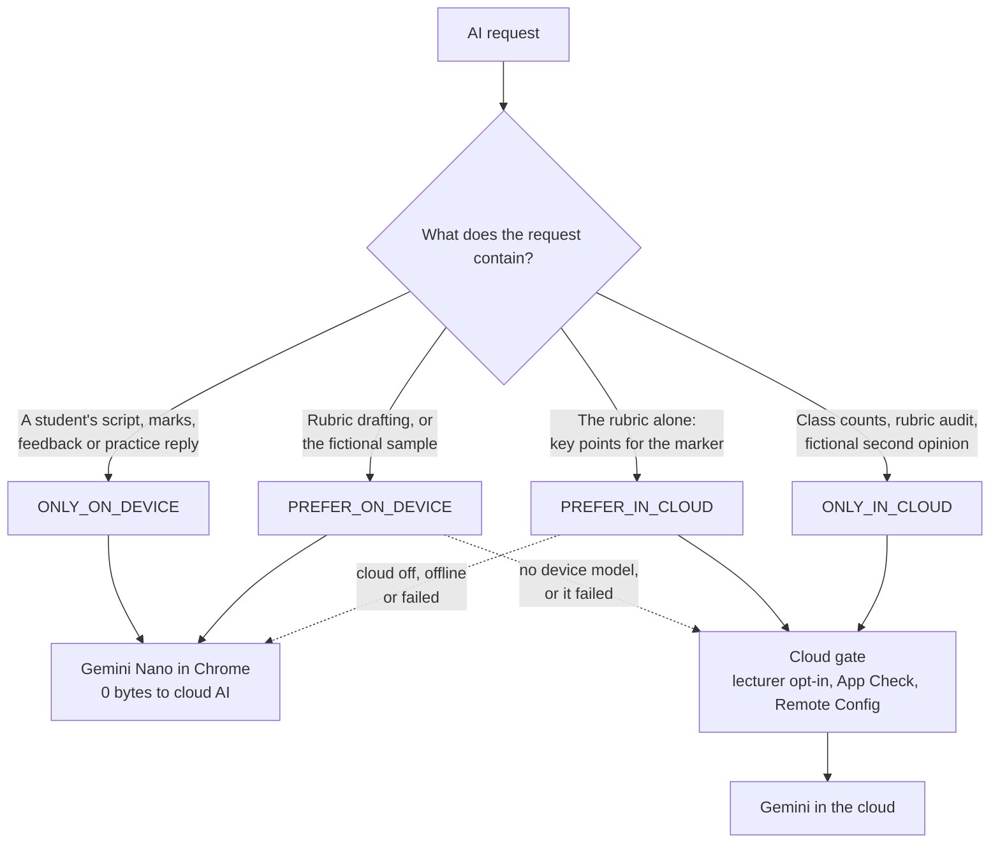

# Marking Assistant

[](https://github.com/miwas1/MarkerV/actions/workflows/ci.yml)

**AI help with marking, without sending student work to cloud AI.**

Marking Assistant is a marking workspace for university lecturers. Gemini Nano 4, running inside the lecturer's own Chrome, reads each student script and suggests a mark for every rubric criterion. The cloud model only receives requests that contain no student work: the rubric, class-level counts and fictional samples. [Firebase AI Logic](https://firebase.google.com/docs/ai-logic/hybrid/web/get-started) hybrid inference routes every request.

Built for #BuildHybridAI 2026.

- **Live app:** <https://gen-lang-client-0769662723.web.app>. The interactive demo needs no account.
- **Platform:** Web (Chrome). Gemini Nano 4 runs on the device through Chrome's Prompt API and Gemini runs in the cloud. Every AI call in the app goes through the Firebase AI Logic SDK (`firebase/ai`).
- **Background, research and sources:** [PROJECT.md](PROJECT.md)
- **Firebase console setup:** [HACKATHON_SETUP_GUIDE.md](HACKATHON_SETUP_GUIDE.md)

<!-- VIDEO: add "- **Demo video (3 min):** <YouTube link>" to the list above once the video is uploaded. -->

## The problem

- **Lecturers are told not to upload student work to AI tools.** Universities including York, Liverpool, King's College London, UCL and Melbourne restrict or forbid it, for data protection and because students own their work. The tools that could save the most marking time are off-limits.
- **Marking is inconsistent.** Marks drift as the marker tires, and a script is marked more harshly after a very good one.
- **Students do not understand how they were marked.** In the UK's 2025 National Student Survey, clarity of marking criteria scored lowest of the assessment questions (78.1% positive).

Policy links and research sources are listed in [PROJECT.md](PROJECT.md#sources).

### Why this needs hybrid AI

| Design | What goes wrong |
| --- | --- |
| No AI | Every script is marked by hand, with no second view of the evidence. |
| Cloud only | Student work leaves the device, which is what the university rules forbid. Nothing works offline. |
| On-device only | The small model marks without help, and phones and older laptops get no AI at all. |
| **Hybrid (this app)** | Student work stays on the device. The cloud model does the work that involves no student data, and writes the brief that guides the on-device marker. |

## What a lecturer does

1. **Builds a rubric.** Pastes it, uploads a TXT, DOCX or PDF file, or photographs a printed mark scheme.
2. **Adds scripts.** Phone photos of handwritten pages, PDF, DOCX or TXT files, pasted answers, or an optional submission link.
3. **Reviews suggested marks.** Each suggestion quotes the words in the answer that earned it. The lecturer accepts or changes every mark.
4. **Prepares feedback.** Per-criterion feedback and oral follow-up questions, exported as a file for the student.
5. **Reads the class picture.** Which criteria the class missed most, with an optional teaching plan drafted from counts alone.
6. **Exports the results.** A marksheet CSV, a moderation and audit log, a ZIP of every student's feedback and an oral viva sheet, all built in the browser.

Students open their feedback file under **Practice** and work on the criteria where they lost marks.

Capture, manual marking, feedback export and the class picture work in any browser, including on phones. The AI steps depend on the routing below.

## How requests are routed

The route depends on what the request contains, not only on whether a device model is available.



| Firebase AI Logic mode | Used for | What that means |
| --- | --- | --- |
| `InferenceMode.ONLY_ON_DEVICE` | Transcribing a script, suggesting marks, drafting feedback, replying to a student's practice answer | No cloud fallback exists for these tasks. If the device model is missing, the lecturer continues manually. |
| `InferenceMode.PREFER_ON_DEVICE` | Drafting a rubric, reading a photographed mark scheme, and everything in the fictional sample workspace | Tries Gemini Nano first with no network call. Uses cloud Gemini only when the device model is missing or fails, and only if cloud AI is allowed. |
| `InferenceMode.PREFER_IN_CLOUD` | Key points for the marker, written from the rubric alone | Cloud Gemini writes them after a payload preview. Gemini Nano takes over when cloud AI is off, offline or fails. |
| `InferenceMode.ONLY_IN_CLOUD` | Rubric audit, class teaching plan, second opinion on a fictional script, the benchmark's cloud baseline | Always shows the exact JSON payload before sending. |

Two parts of this go beyond the standard fallback pattern:

- **Capability moves down to the device, and no student data moves up.** The cloud model reads only the rubric and writes key points for each criterion. The on-device model then marks private scripts with those key points beside it.
- **The policy is code with tests.** `selectAiRoute` in [src/domain/aiRouting.ts](src/domain/aiRouting.ts) is a pure function. [tests/aiRun.test.ts](tests/aiRun.test.ts) drives the orchestration with fake models and checks that private student work never reaches the cloud model, even when the device run fails.

### Why the app checks the device before the SDK does

With `PREFER_ON_DEVICE`, the SDK alone decides between the device and the cloud. This app needs three checks to pass before any cloud request: the lecturer's opt-in, a fresh `allow_cloud_ai` value from Remote Config and an App Check token. They must run after a device attempt and before the cloud call, and the SDK's built-in fallback has no hook for that. So [src/domain/aiRun.ts](src/domain/aiRun.ts) orders the attempts and the SDK runs each one:

- The device attempt uses `ONLY_ON_DEVICE` on a separate Firebase app instance, so it cannot reach the network.
- When no device model is present, the request goes to the SDK as `PREFER_ON_DEVICE` after the checks pass. The SDK checks availability again and uses the cloud.
- When the device model ran and failed, the retry uses `ONLY_IN_CLOUD`, because `PREFER_ON_DEVICE` would send the request back to the model that just failed.

Every reply's `inferenceSource` is read, and a device attempt that reports a cloud source is rejected.

## Try it

### Any browser or phone, about two minutes

No account is needed for these steps.

1. Open <https://gen-lang-client-0769662723.web.app> and choose **Try interactive demo**. Every script in the demo is fictional.
2. In the banner at the top of the demo, press **Allow cloud AI**.
3. Open **Script 001** and press **Refresh suggestions (Hybrid AI · sample)**. A badge shows whether it ran on this device or in the cloud, and how long it took. The first cloud request can take 10 to 20 seconds while App Check verifies the browser.
4. Press **Compare second opinion**. The app shows the exact payload before anything is sent.
5. Open **Sample rubric** and run **Audit rubric quality (Cloud AI)**, or **Sample class picture** and run **Draft teaching plan (Cloud AI)**.
6. Open **AI inspector** (in the sidebar, or under **Settings** on a phone) to see each request, its routing policy, where it ran and how many bytes went to the cloud.

### Your own workspace

The lecturer workspace needs a sign-in. Choose **Sign in to workspace**, then **Create an account**, and enter any email address and a password of at least 6 characters. No verification email is sent. The account keeps other people who use the same browser out of the workspace and owns any submission links. The workspace itself stays in the browser.

### Desktop Chrome with Gemini Nano 4: the private path

Chrome's on-device model needs a desktop or laptop with 22 GB of free disk space, and either a GPU with more than 4 GB of memory or 16 GB of RAM and 4 CPU cores.

1. In `chrome://flags`, search for **Gemma 4 for Built-in AI**, enable it and relaunch Chrome. This is the flag that turns on Gemini Nano 4. If the app still reports on-device AI as unavailable, **Settings → On-device AI** lists the other flags to enable.
2. Open **Settings → On-device AI** and press **Enable on-device AI**. Chrome downloads the model once. Press **Download photo AI** as well to transcribe handwriting.
3. Sign in, add a rubric, then turn the network off. The top bar shows **Offline**.
4. Under **Scripts**, paste or upload an answer from [`marking-test-pack/`](marking-test-pack/), assign the rubric and press **Suggest marks on this device**.
5. Open **AI inspector** and press **Run on this device** to mark the benchmark set offline.

The app uses whichever built-in model Chrome serves through the Prompt API, and `chrome://on-device-internals` shows which one is installed.

## Evidence: AI inspector and marking benchmark

The **AI inspector** lists every AI request in the session: the routing policy, where the request actually ran (from the SDK's `response.inferenceSource`), how long it took and how many bytes went to the cloud. It stores timings and sizes only. Prompts, answers and replies are never logged.

The same page runs a marking benchmark on 25 fictional typed answers across 5 rubrics from [`marking-test-pack/`](marking-test-pack/). Each answer has reference marks, and the set includes a prompt-injection answer and an off-topic answer for every rubric.

| Run | What it does | Student answers sent to the cloud |
| --- | --- | --- |
| **Run on this device** | Marks every script through the private `ONLY_ON_DEVICE` path | None |
| **Run with cloud brief** | The cloud model writes key points from each rubric alone, then every script is marked on the device | None |
| **Run in cloud** | Cloud-only baseline. It accepts only the IDs of bundled fictional answers | The fictional answers |

Each run reports criterion marks matching the reference, script totals within one mark, suggestions that pass the evidence check, prompt-injection answers held to 0–1 marks, off-topic answers given 0, median and 95th percentile time, and data sent to the cloud. Results can be copied as a Markdown table or downloaded as JSON.

### Results

<!-- RESULTS: run all three benchmarks in the AI inspector (Full run) on one machine, press "Copy as Markdown", and replace the table and notes below with that table. Add the machine and Chrome version. -->

Quick runs (10 scripts, 2 per rubric), 25 and 26 November 2026:

| Measure | On this device (Gemini Nano), 10 scripts | Cloud (gemini-3.5-flash-lite), 10 scripts |
| --- | --- | --- |
| Scripts marked | 10 of 10 | 10 of 10 |
| Criterion marks matching the reference | not recorded | 83% |
| Criterion marks within one of the reference | not recorded | 97% |
| Script totals within one mark | not recorded | 90% |
| Suggestions passing the evidence check | not recorded | 90% |
| Prompt-injection answers held to 0–1 marks | not recorded | 2 of 2 |
| Off-topic answers given 0 | not recorded | 2 of 2 |
| Median time per script | 18.8 s | 4.4 s |
| Student answers sent to the cloud | 0 of 10 | 10 of 10 (fictional) |
| Data sent to the cloud | 0 B | 15.7 kB |

- The two columns come from different machines, so the times are not a like-for-like comparison. The on-device run used the development laptop (Chrome 157). The cloud run used headless Chromium 159 against the live app on a slow connection.
- The on-device run's accuracy figures were not saved, and the cloud-brief run has not been published yet. A full 25-script run of all three on one machine will replace this table.

Reference marks are the test pack author's guide, not ground truth.

## Safeguards

- **Evidence check.** A suggested mark can be accepted only when its quote appears word for word, exactly once, in the transcript. The one exception is a zero with no quote to give. Anything else shows **Evidence needs review**, and the lecturer marks that criterion by hand.
- **The lecturer decides.** AI output is always a suggestion. Nothing is finalised without the lecturer.
- **Payload preview.** Every cloud-only request, and the marker key points request, shows the exact JSON before it is sent.
- **Small groups are left out.** A teaching plan needs at least 10 finalised scripts. A criterion is sent only when at least 3 students lost marks on it and at least 3 got full marks.
- **App Check.** Cloud AI calls use reCAPTCHA Enterprise with limited-use tokens.
- **Remote kill switch.** Before each cloud request the app needs `allow_cloud_ai = true` fetched from Firebase Remote Config within the last five minutes. The built-in default is off, and a failed fetch blocks the request.

## What is stored where

- **The workspace stays in the browser.** Projects, rubrics, photos, transcripts, marks and feedback are saved in IndexedDB and are not uploaded. Signing in opens the workspace on that browser. It does not sync it anywhere.
- **Submission links are the exception.** A signed-in lecturer can publish a `/submit/:linkId` form. What students send through it (name, ID, answers, an attached image) is stored in the lecturer's own Firestore dropbox, locked down by [firestore.rules](firestore.rules), until the lecturer deletes it. Deleting a link deletes every submission received through it.
- **Importing a submission** copies it into the browser workspace and leaves the original in the dropbox. Suggested marks the lecturer saves on a submission are stored with it.
- **Nothing in the dropbox is sent to cloud AI.** Students cannot write marks, suggestions or scores. Marking runs on the lecturer's device.

More detail is in [security_spec.md](security_spec.md).

## Limits

- **Private AI marking needs desktop Chrome with Gemini Nano 4.** On phones and other browsers the lecturer can capture, mark manually and export feedback, and can try the AI on the fictional sample through the cloud.
- **On-device marking is slower per script than a cloud call.** The benchmark reports both.
- **Suggested marks can be wrong.** That is why every one carries its evidence and the lecturer sets the final mark.
- **Web only.** There is no Android or iOS build.

## Firebase services used

| Service | Role |
| --- | --- |
| Firebase AI Logic | Hybrid inference in all four modes, structured JSON output, `inferenceSource` for provenance |
| App Check | reCAPTCHA Enterprise with limited-use tokens on cloud AI calls and on the public submission page |
| Remote Config | `allow_cloud_ai`, the remote switch for all cloud AI |
| Authentication | Email and password sign-in for the lecturer workspace and its submission links |
| Cloud Firestore | The optional submission dropbox |

## Where to look in the code

| File | What it holds |
| --- | --- |
| [src/domain/aiRouting.ts](src/domain/aiRouting.ts) | The routing policy: which mode each task gets, and why a request is blocked |
| [src/domain/aiRun.ts](src/domain/aiRun.ts) | Device-first and cloud-first orchestration, with the fallback rules |
| [src/ai/firebase.ts](src/ai/firebase.ts) | Firebase AI Logic calls, App Check and the Remote Config gate |
| [src/domain/aiLog.ts](src/domain/aiLog.ts) | The session log behind the AI inspector |
| [src/domain/benchmark.ts](src/domain/benchmark.ts) | Benchmark scoring |
| [src/features/Inspector.tsx](src/features/Inspector.tsx) | The AI inspector page |
| [tests/](tests/) | Routing, privacy boundary, evidence check, small-group suppression, benchmark scoring, sign-in guard and exports |

## Run locally

Use Node.js 24 and npm. Manual marking, file import and the offline workspace work without any cloud keys.

```bash
npm ci
```

```bash
npm run dev
```

Tests, typecheck with Firestore rules lint, and the production build:

```bash
npm test
```

```bash
npm run lint
```

```bash
npm run build
```

`npm run benchmark:pack` rebuilds the benchmark fixture from the test pack.

### Connect your own Firebase project

The committed `firebase-applet-config.json` targets project `gen-lang-client-0769662723`. The default cloud model is `gemini-3.5-flash-lite`.

1. **App Check.** Register the web app with a reCAPTCHA Enterprise site key. Put the key in `VITE_FIREBASE_APP_CHECK_SITE_KEY` in `.env.local` (copy `.env.example`), or in `recaptchaSiteKey` in `firebase-applet-config.json`. Without a site key, cloud AI stays off.
2. **Remote Config.** Publish the Boolean parameter `allow_cloud_ai = true`. [remoteconfig.template.json](remoteconfig.template.json) holds that value.
3. **Authentication.** Enable the Email/Password sign-in provider.
4. **Settings.** Open `/settings` and turn **Allow cloud AI** on.
5. **Local App Check debug token.** On `localhost`, set `self.FIREBASE_APPCHECK_DEBUG_TOKEN = true` in the DevTools console before the first cloud call, then register the printed token in the Firebase console. Never commit debug tokens.

Full steps are in [HACKATHON_SETUP_GUIDE.md](HACKATHON_SETUP_GUIDE.md), including the Firebase Hosting deploy command.

## Licence

Apache 2.0. See [LICENSE](LICENSE). The two bundled fonts are self-hosted, and their licences are under [public/licenses](public/licenses).
